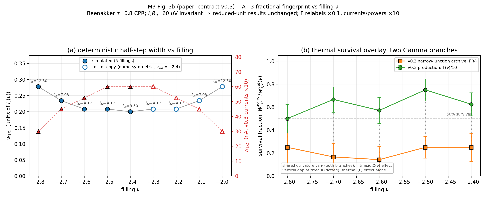
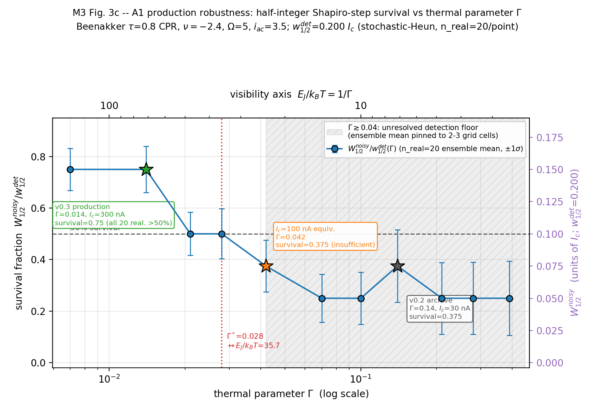
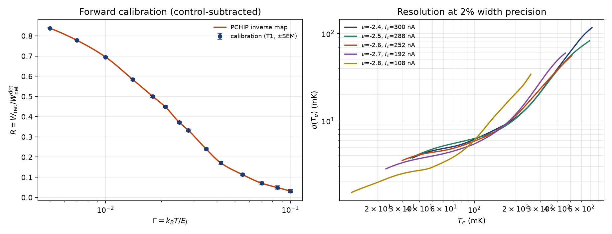
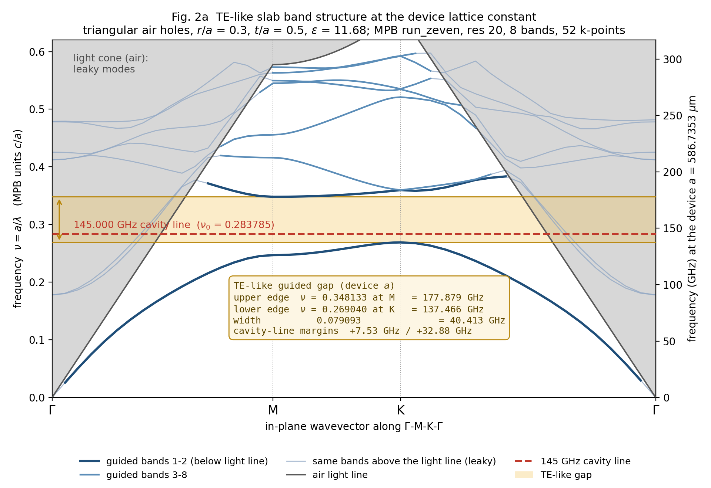
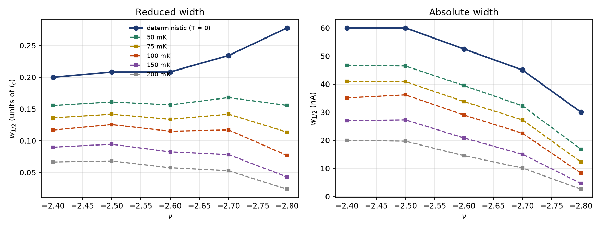
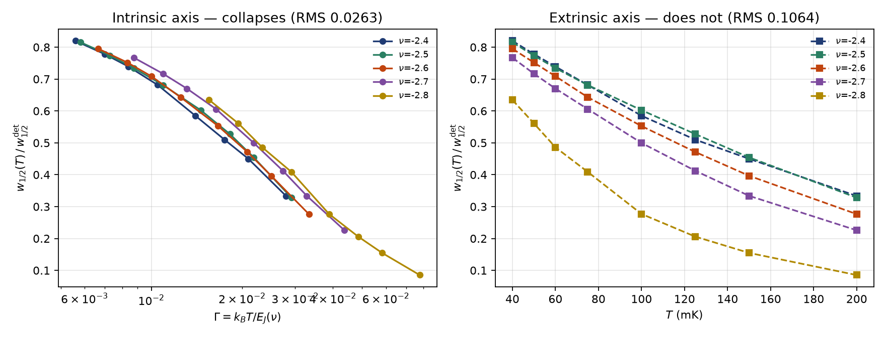

# Fractional Shapiro steps as a current–phase fingerprint of a magic-angle TBG Josephson junction in a sub-terahertz photonic-crystal cavity

**Status:** Manuscript in preparation (unpublished). This is a computational **design study**: no device has been fabricated. "Measured" below means measured on the stated simulation.

## Question

A short, highly transparent Josephson junction has a skewed (non-sinusoidal) current–phase relation (CPR). Under microwave drive, CPR harmonics m ≥ 2 open fractional Shapiro steps at V = (n/m)·ħω/2e. Can the half-integer step of a gate-defined magic-angle twisted-bilayer-graphene (MATBG) junction, driven at the gap frequency through a sub-THz silicon photonic-crystal cavity, serve as a quantitative CPR fingerprint? And how robust is it at the electron temperatures an experiment will actually reach?

## Method (module chain)

1. **M1 material**: Bistritzer–MacDonald flat bands, phenomenological superconducting dome, Beenakker short-junction CPR (`scripts/m1/`, `scripts/m1_reference.py`).
2. **M2 photonics**: plane-wave-expansion bands, MEEP/MPB 2D/3D L3 defect cavity and side-coupling ladder (`scripts/m2_*.py`, `scripts/pwe_reference.py`).
3. **M3 junction**: overdamped RSJ / RSJ–Langevin Shapiro maps, thermal survival, floor-free step-width estimator, inverse thermometer (`scripts/junction/`, `scripts/rsj_reference.py`, `scripts/run_*.py`, `scripts/make_thermometer.py`).
4. **M4 integration**: power chain, junction loading (Q_J closure), quasiparticle back-action, thermal budget (`scripts/integration/`).

## Key results (numbers from the stored artifacts in `results/`)

- **Material.** Flat-band minimum at θ = 1.025°, converged flat-band width 2.92 meV, remote-band gap 40.7× the drive-photon energy, so the drive addresses an isolated flat manifold.
- **Fingerprint.** The Beenakker CPR at τ = 0.8 (a representative model choice, not a derived value) has c₂/c₁ = −0.187. At the dome centre the half-integer step has reduced width **0.200 I_c** at i_ac = 3.5, four times the 0.05 sinusoidal control floor. At the device parameters I_c = 300 nA, R_n = 200 Ω (Ω = 5.0, f = 145 GHz) that is **60 nA**.
- **Filling dependence at T = 0.** The reduced width rises from 0.200 to 0.278 between ν = −2.4 and −2.8 while the absolute width falls from 60 to 30 nA.
- **Finite temperature, floor-corrected.** The estimator is a Gaussian-kernel width over 160 realizations, with a sinusoidal-CPR control subtracted at every Γ = k_BT/E_J. Survival at Γ = 0.014 (100 mK) is **0.585**. 50 % survival is reached at **Γ\* = 0.0180**, i.e. **E_J/k_BT > 55.5** or T_e < 129 mK at the dome centre. The older plateau-count convention gave Γ\* = 0.028 (E_J/k_BT > 35.7). The whole shift comes from the estimator floor: the control reads 0.0575–0.0593, flat across a 20× range of Γ, which is 30.4 % of the deterministic width. Narrowing the junction to I_c = 100 nA is not enough (17.1 % survival).
- **The zero-temperature filling signature inverts above ≈ 50 mK** (`results/out/dome_map_thermal.json`). A collapse protocol replaces it: survival collapses when plotted against Γ = k_BT/E_J(ν) and fails to collapse against T alone (wrong-axis/right-axis residual ratio 4.0, `results/out/collapse_test.json`).
- **Electron thermometer (T1/T2 extension, merged PR "turn the half-step fingerprint into a T_e instrument").** The floor-free curve is invertible: R = W_net/W_net,det → Γ → T_e, with dynamic range 0.838 → 0.032. At ν = −2.4 the usable window is 36–715 mK with σ_T = 3.8 mK at 2 % width precision. Across fillings the window is 13–715 mK with σ_T = 1.5–3.8 mK, but only ν = −2.4 is directly calibrated; the other fillings are flagged where extrapolated. Observing R ≥ 0.5 alone bounds T_e < 129 mK at ν = −2.4 (< 58 mK at ν = −2.8).
- **Cavity.** Tuned L3 defect (s = 0.20a, r_def = 1.15) in high-resistivity Si. Lattice constant a = 586.74 µm puts the line at 145.000 GHz inside a 137.5–177.9 GHz TE-like gap. Q_rad = 2.7–3.0×10⁴, Q_mat = 5.2×10⁴, in-situ Q_i = 1.46×10⁴, V_mode = 0.331 a³.
- **Power chain.** 90 nW → 900 pW → V_ac = 0.600 mV → α = 1.000.

<p align="center"> </p>
<p align="center"> </p>
<p align="center"> </p>

## Negative and limiting results

- **Junction loading.** With a bare van-der-Waals stack (collection length d_eff = 100 nm) the junction is a negligible loss channel: Q_J = 1.26×10⁸, and it sees about 1 µV of ac drive instead of 600 µV. An engineered collection structure with d_eff ≈ 20–25 µm is **required**, and every result above assumes it.
- **Electron-temperature risk.** A parametric estimate gives T_e ≈ 0.6 K at the reference load. At that temperature the corrected survival would be ≈ 0.05, i.e. no measurable step. This is the largest open physical question.
- **Not a clean intrinsic/extrinsic discriminant.** The companion boundary study ([matbg-subthz-limits](https://github.com/FarukSamiBilgin/matbg-subthz-limits)) finds that the step faithfully probes *transparency*. Its filling and twist dependence, however, is degenerate with trapped-vortex and multiple-Andreev-reflection mimics, and the 145 GHz drive sits at or above the pair-breaking edge (ħω/2Δ = 0.99–1.9). This weakens the long draft's "dome-map discriminant" framing; read the two studies together.
- The ν = −2.8 point holds R_n fixed at its dome-centre value, so it transfers least well to a real device sweep.

## How results were verified

- **Independent re-derivations.** `scripts/m1_reference.py`, `scripts/rsj_reference.py` and `scripts/pwe_reference.py` reproduce the production modules.
- **RSJ benchmarks.** The model reproduces the Tien–Gordon/Bessel limit (first zero at i_ac = 11.90 vs theory 12.02) and a stand-in-CPR half-step (width 0.250, 5× the floor).
- **Convergence.** Going from 60 to 120 steps per period changes v by at most 1.5×10⁻⁵.
- **Tests.** The pytest suite in `scripts/tests/` covers the material, photonic (2D TCMT), junction, power-chain, Q_J-loading, back-action/thermal and thermometry modules. The thermometry tests check the estimator against a closed form, grid convergence, PCHIP against scipy (to 1e-12), the inversion round-trip and seed-collision freedom.
- **Traceability.** In the manuscript source, every number is traced to a committed artifact.

## Repository layout

- `figures/`: figures, with `.caption.txt` files where available
- `results/`: JSON contracts (`material.json`, `photonics.json`, `integration.json`, …). `results/out/` holds the run outputs: fingerprint, survival, thermometry calibration, dome map, collapse test, Q_J closure, M1 refinement and the M2 cavity runs (`results/out/m2/`).
- `scripts/`: production modules (`m1/`, `junction/`, `integration/`), run and figure scripts, reference re-derivations, `tests/`
- `paper/ABSTRACT.md`: extended abstract

## Reproducing

```bash
pip install -r scripts/requirements.txt   # photonic scripts also need MEEP/MPB
```

The scripts are copied unchanged from the original project. That project kept the JSON contracts at the repository root and the outputs under `out/`. To re-run, restore that layout: copy `results/*.json` to the root and `results/out/` to `out/`. Then run, for example, `pytest tests/`, `python scripts/run_thermometry_calibration.py` and `python scripts/make_thermometer.py`. The figures and results here are the stored artifacts of the original runs; they were not regenerated for this release. The Langevin production runs are CPU-heavy (about 2000 s on 4 cores for the calibration).

## Related work by the author

- Twisted hBN preprint: https://doi.org/10.5281/zenodo.24201814
- Twisted MoS2 hole-spin coherence preprint: https://www.alphaxiv.org/abs/2611.twisted-mos2-hole-spin-coherence
- Moiré microwave loss preprint: https://doi.org/10.5281/zenodo.24204124 (code: https://github.com/FarukSamiBilgin/moire-microwave-loss)
- josim-cpr-bridge: https://github.com/FarukSamiBilgin/josim-cpr-bridge
- Companion repositories on the same platform: [tbg-gatemon](https://github.com/FarukSamiBilgin/tbg-gatemon), [matbg-subthz-limits](https://github.com/FarukSamiBilgin/matbg-subthz-limits)

## AI assistance

AI assistance: AI coding assistants were used for code development and for adversarial review. All load-bearing results were re-derived by independent methods and checked by automated tests; the author is responsible for every claim.

## Citation

See `CITATION.cff`. Faruk Sami Bilgin (Independent Researcher, ORCID 0009-0001-9064-4410), *Fractional Shapiro steps as a current–phase fingerprint of a magic-angle TBG Josephson junction in a sub-terahertz photonic-crystal cavity*, manuscript in preparation (2026).

## License

Code: MIT (`LICENSE`). Text, figures and data: CC BY 4.0 (`LICENSE-CONTENT`).
